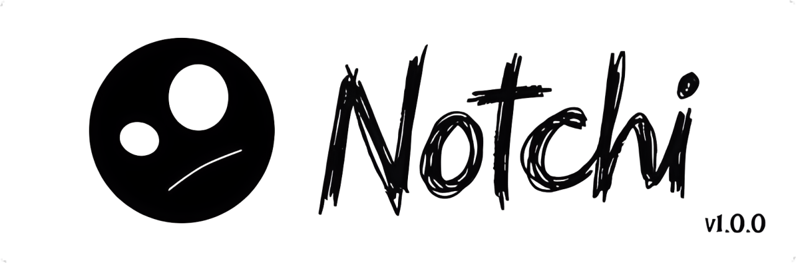

  

  <a href="README.md">English</a> | <a href="READMEindo.md">Bahasa Indonesia</a>

## Overview

Notchi is a native notch overlay for Windows 10 and Windows 11, inspired by the macOS notch and Dynamic Island. It stays above the desktop, remains compact while idle, and expands on hover to show media controls and system information. The application is built with C#, WPF, and .NET 8 without Electron, keeping it lightweight and responsive.

## System Requirements

| Component | Minimum | Recommended |
| :--- | :--- | :--- |
| Operating system | Windows 10 version 2004 (build 19041), 64-bit | Windows 11 version 22H2 or later, 64-bit |
| Architecture | x64 | x64 |
| Processor | 1 GHz dual-core or equivalent | 2 GHz quad-core or equivalent |
| Memory | 4 GB RAM | 8 GB RAM |
| Storage | 150 MB free space | 250 MB free space on an SSD |
| Display | 1280 x 720 | 1920 x 1080 or higher |

The release installer is per-user and does not require administrator privileges.

## Features

| Feature | Description |
| :--- | :--- |
| Always-on-top overlay | Keeps the notch visible above other windows without appearing in the taskbar. |
| Compact and expanded modes | Stays compact while idle and expands smoothly when the cursor moves over it. |
| Media controls | Integrates with Windows System Media Transport Controls for track title, artist, album art, source app, elapsed time, duration, seeking, play/pause, and previous/next. |
| System dashboard | Displays the clock, date, battery status, and live CPU, RAM, and disk usage. |
| Notes | Provides a dedicated notes window with automatic saving. |
| File drop shelf | Accepts files dragged onto the notch and supports opening files, revealing them in Explorer, copying paths, opening all items, and clearing the list. |
| Screen anchoring | Lets the notch be dragged to the top center, left center, or right center of the screen. |
| Persistent position | Saves the last anchor and restores it on the next launch. |
| Settings | Controls which system metrics are visible and whether the app starts with Windows. |
| Lightweight design | Uses native WPF rendering with low idle CPU usage and private memory below 100 MB. |

## Latest Update

| Version | Released | Status |
| :--- | :--- | :--- |
| 1.0.1 | October 21, 2026 | Latest stable |

Version 1.0.1 is the current stable release, focused on stability, safer note storage, and a more complete installer experience. Full release notes are available on the [Releases](https://github.com/risuunava/Notchi/releases) page.

## Contributing

Contributions are welcome, including bug reports, feature proposals, documentation improvements, and pull requests. Before contributing, read [CONTRIBUTORS.md](CONTRIBUTORS.md) for the contributor list, roles, and contribution workflow. For significant changes, open an issue first so the approach can be discussed.

  
  

## Contact

Developer: **risuunava**

  
  
  

## License

Notchi is released under the Apache License 2.0. See [LICENSE](LICENSE) for details.
